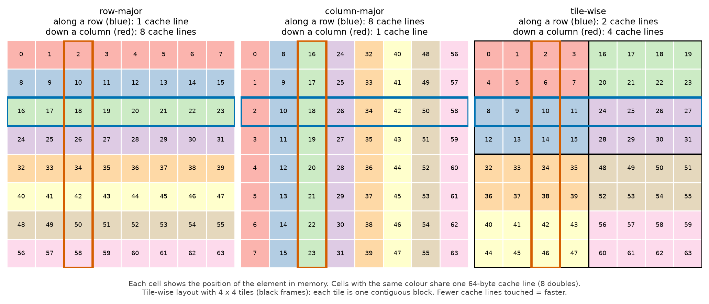
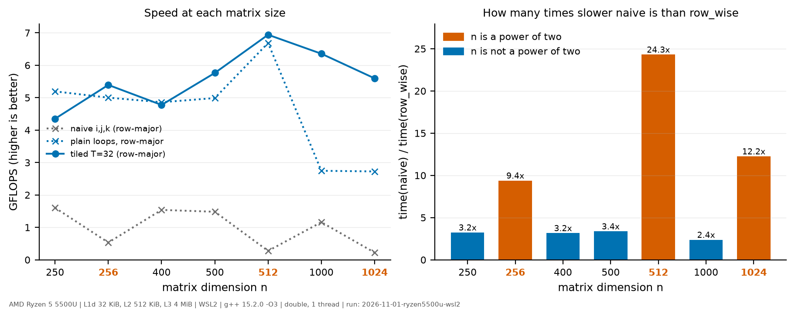
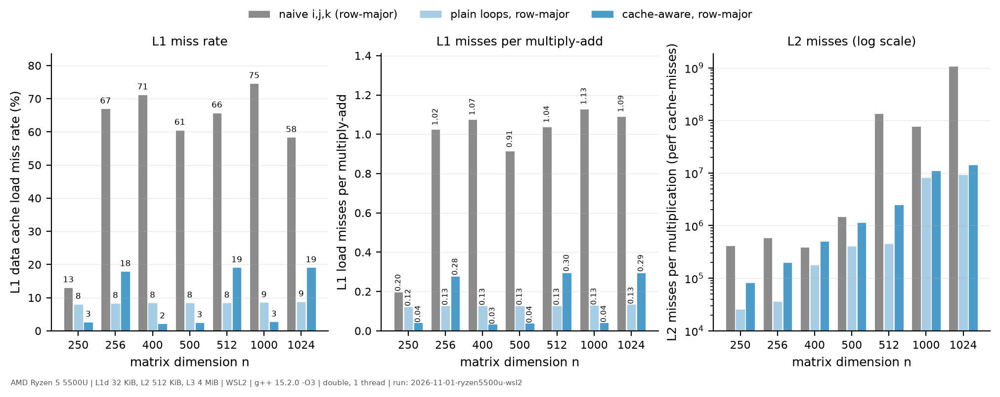
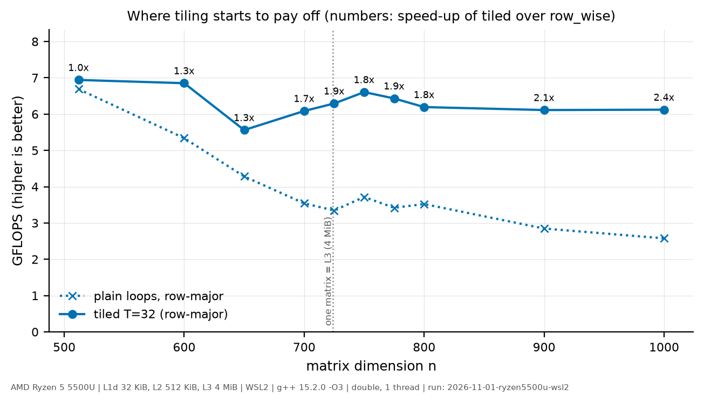
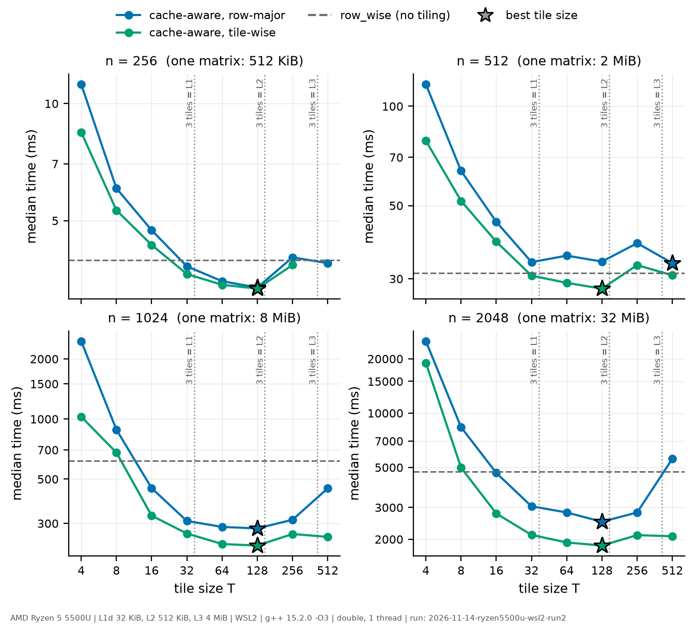
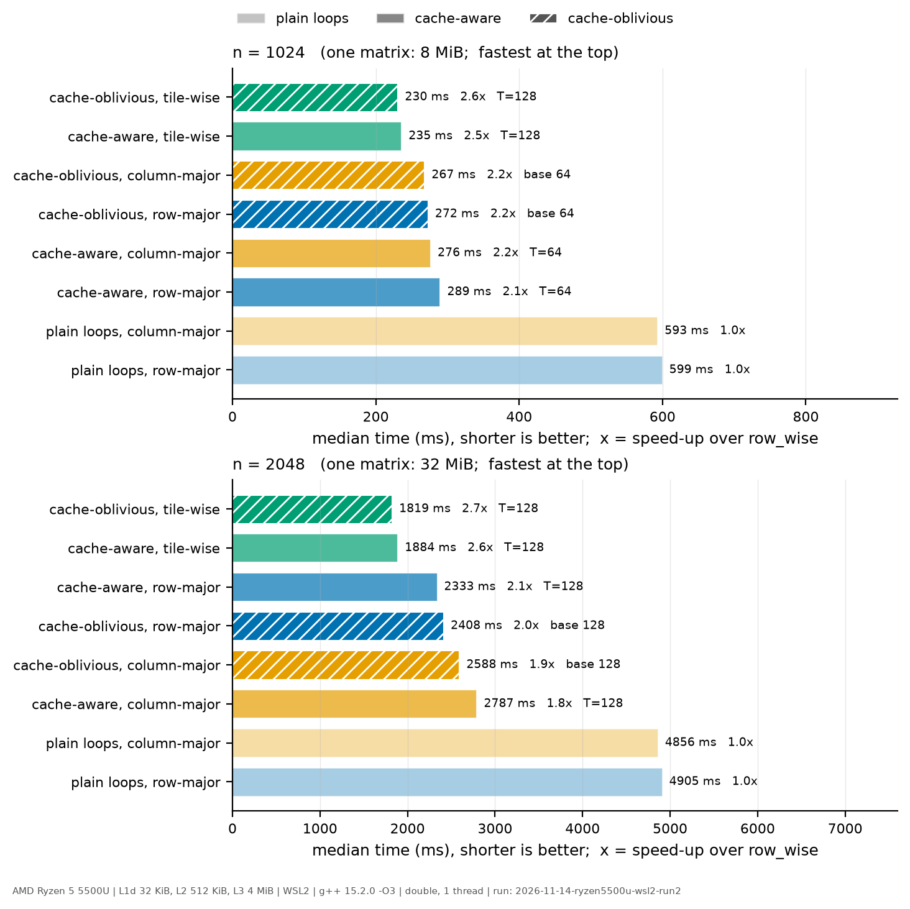
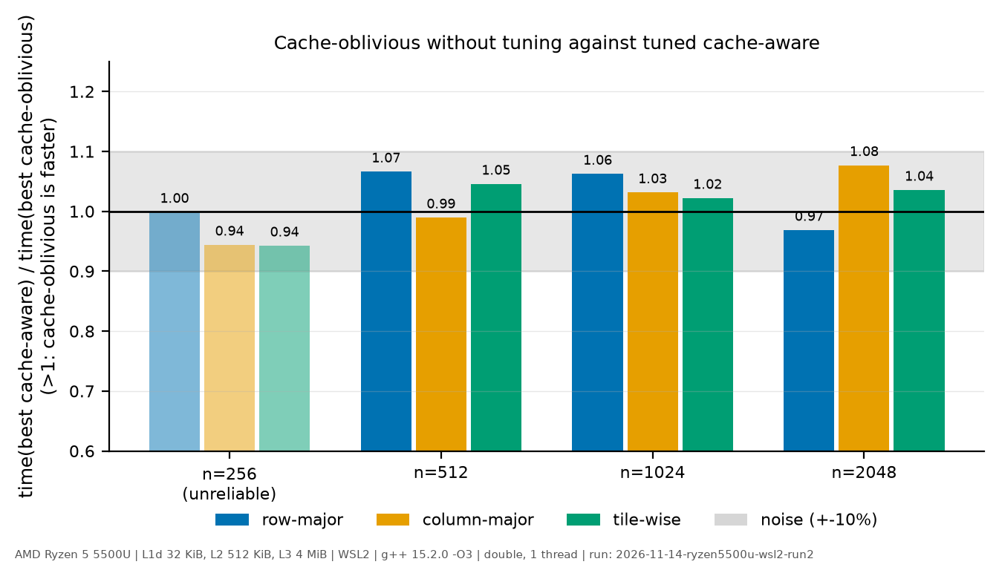

# Experiment 01: Matrix multiplication and the cache

**Status:** done (2026-10-13 to 2026-11-15). Short version: [docs/findings.md](../../docs/findings.md). What was asked and when: [docs/agenda.md](../../docs/agenda.md). Hardware background: [docs/theory/caches.md](../../docs/theory/caches.md).

## 1. Question

`C = A * B` for square `n x n` matrices of `double` always does the same `n³` multiply-adds; only the order of the memory accesses changes. The professor's tasks, in short:

1. Matrices are stored row by row. Walking along a row is cache friendly, walking down a column is not. How much does that cost, and can it be improved? (2026-10-13)
2. How many cache misses should each version have in theory, what is the lower bound, and how do the versions behave when the whole matrix fits in the cache, when only a row fits, and when not even a row fits? Which cache are we measuring? (2026-11-01)
3. Do cache-aware (tiled) and cache-oblivious (recursive) algorithms help, on row-major, column-major and tile-wise storage? How does the tile size matter, and what happens when the tile or the matrix does not fit in the cache? (2026-11-14)

## 2. Versions

All in [`main.cpp`](main.cpp). Every version computes the same product with the same summation order and prints the same checksum; each run checks its result against a reference version before timing.

| | row-major | column-major | tile-wise |
| --- | --- | --- | --- |
| plain loops | `naive` (loops i, j, k), `row_wise` (i, k, j) | `col_wise` (j, k, i) | - |
| cache-aware (tile size T) | `tiled` | `tiled_col_major` | `tiled_tile_wise` |
| cache-oblivious (recursive) | `oblivious_row_major` | `oblivious_col_major` | `oblivious_tile_wise` |

- `naive` is the textbook loop: its inner loop walks **down a column** of B (a jump of `8n` bytes per step). `row_wise` swaps the two inner loops, so the inner loop walks **along rows** of B and C.
- `tiled` does the `row_wise` loops on one `T x T` tile of A, B and C at a time, so the three tiles can stay in the cache.
- Layouts: row-major stores element (r, c) at `r*n + c`, column-major at `c*n + r`, tile-wise stores each `T x T` tile as one contiguous block. The input is converted to the layout before timing.
- Cache-oblivious: the largest of the three loop ranges is halved recursively until the block is small. It never uses a cache size; at some depth the blocks fit in every cache level by themselves. On the tile-wise layout the tile size is part of the layout, so that version is only partly oblivious.



How the recursion splits the work: [recursion diagram](../../docs/01-matrix-multiplication/diagrams/recursion_steps.png).

## 3. Theory

The model is the ideal cache: one cache of `Z` elements with lines of `L` elements, fully associative, optimal replacement; `Q` = number of lines moved into the cache (misses). Here `L = 8` doubles (64 bytes) and `Z` = 4096 (L1, 32 KiB), 65 536 (L2, 512 KiB) or 524 288 doubles (L3, 4 MiB). Two counting rules: a contiguous walk of `m` elements costs `m/L` misses; a walk with a stride of a line or more costs `m` misses unless those lines are still in the cache.

| Version | Misses `Q` (one cache level) | Condition |
| --- | --- | --- |
| `naive` | `n³/L + 2n²/L` | the column of B (n lines) fits in the cache and does not collide in a few sets |
| `naive` | `≈ n³` | otherwise (on L1: from n ≈ 455, or earlier through set conflicts) |
| `row_wise` (= row-major times column-major, the professor's case b) | `n³/L + 2n²/L` | two rows fit (`2n ≤ Z`) |
| `tiled`, `d x d` tiles | `2n³/(dL) + n²/L` | three tiles fit (`3d² ≤ Z`); best `d ≈ √(Z/3)`: 37 for L1, 148 for L2 |
| any algorithm with `n³` multiply-adds | `≥ 2n³/(L√Z)` | lower bound (Hong and Kung 1981; tight constant: Smith et al., arXiv:1702.02017) |
| any algorithm | `≥ 3n²/L` | read A and B once, write C once |

**The lower bound** is a proof, not a measurement: no loop order can move fewer lines (Strassen-type algorithms can, because they do fewer multiplications). On L1 it is `n³/256`. `naive` is 256 times above it, `row_wise` 32 times, `tiled` with d = 32 two times. The cache-oblivious recursion meets the bound at every cache level without knowing `Z` (Frigo et al. 1999).

**The three regimes** have to be read per cache level, because L1, L2 and L3 have different `Z`:

| Regime | L1 | L2 | L3 | Expected behaviour |
| --- | --- | --- | --- | --- |
| (a) whole matrix < cache (`n² < Z`) | n < 64 | n < 256 | n < 724 | only the compulsory misses; all versions close |
| (b) one row < cache < whole matrix | 64 ≤ n ≤ 4096 | n ≥ 256 | n ≥ 724 | `row_wise` `n³/L`, limited by bandwidth; `naive` `n³` when the column does not fit or collides, limited by latency; `tiled` `2n³/(dL)` |
| (c) cache < one row (`Z < n`) | n > 4096 | - | - | `row_wise` `2n³/L` (B and C both stream); `tiled` unchanged while `3d² ≤ Z` |

**What the model leaves out** shows up in the measurements: caches are 8- or 16-way set-associative, so at power-of-two `n` a column of B lands in one or two L1 sets (conflict misses); prefetchers hide latency (the L1 counter includes prefetched lines, the L2 counter does not); the L3 is a victim cache shared by three cores, so less than 4 MiB is usable; the TLB covers only 8 MiB; the allocator puts every matrix at page + 16 bytes, so a row takes one line more. Details: [theory sections 6, 12, 13 and 17](../../docs/theory/caches.md).

## 4. Method

- **Machine:** AMD Ryzen 5 5500U (Zen 2), one thread. L1d 32 KiB (64 sets x 8 ways), L2 512 KiB (8-way), L3 4 MiB (16-way, victim cache), 64-byte lines, 4 KiB pages. WSL2 (Ubuntu), g++ 15.2.0 `-O3 -DNDEBUG` without `-march=native`, so SIMD is SSE2 (2 doubles per instruction). Every results folder has an `environment.txt`.
- **Inputs:** uniform random numbers in [-1, 1], fixed seed; the same checksum for every version and session.
- **Timing:** one warm-up run, then the median of 7 repetitions (5 from n = 1024, 3 at n = 4096). Each version runs in its own process.
- **Counters:** `perf stat`, user-mode events. To remove setup and the reference check, each version runs with 1 and with 1 + R repetitions and the difference is divided by R (R = 30 for n ≤ 512 and 10 above, on 2026-11-01; R = 3 in October, which is too noisy under WSL2). A row is usable when the L1 loads are about `1.5 n³`.
- **Which cache the counters see:** `cache-misses` counts **L2 misses** on this CPU (not last-level misses as on Intel), excluding L2 prefetches. `L1-dcache-load-misses` counts lines brought into L1, including prefetches. WSL2 has no L3 or RAM counters, so L3 effects are seen only in the timings.

| Session (`results/`) | Contents | Used for |
| --- | --- | --- |
| `2026-10-18-ryzen5500u-wsl2` | `naive`, `row_wise`, `tiled` at n = 64-1024; counters (3 runs) at 512, 1024; no-SIMD at 512 | first look |
| `2026-11-01-ryzen5500u-wsl2` | n = 250, 256, 400, 500, 512 and `large-n/` 1000, 1024; counters (30 / 10 runs) with TLB; `l3-sweep/` n = 600-1000; `tile-sweep/` at n = 1000; no-SIMD at 500 | access order, counters, L3 |
| `2026-11-14-ryzen5500u-wsl2-run2` | tile sizes T = 4-512 and all nine versions at n = 256-2048 (laptop on AC power, High performance plan) | tile size, layouts, cache-oblivious |
| `2026-11-14-ryzen5500u-wsl2-run2-n4096` | four runs at n = 4096, stopped for time | indicative only |
| `2026-11-14-ryzen5500u-wsl2` | first tile sweep, noisy (Balanced power plan) | not used |
| `2026-11-15-ryzen5500u-wsl2-counters` | counters for all nine versions, stopped | not used (partial) |

## 5. Results

### 5.1 Access order: `naive` against `row_wise`



- Swapping two loops gives the same result much faster. At sizes that are not powers of two `naive` is **2.4-3.4x** slower than `row_wise` (n = 250, 400, 500, 1000). At powers of two it is **9.4x** (256), **24.3x** (512) and **12.2x** (1024).
- The extra factor at powers of two comes from **conflict misses**. A row is then a multiple of 4096 bytes, so the whole column of B maps to one or two L1 sets of 8 lines each. At n = 512 and 1024 the column also overflows L2: about one L2 miss per multiply-add (136 M and 1089 M per multiplication), against 0.4-1.5 M at n = 250-500.
- n = 1024 takes 5.6 times longer than n = 1000 for 7.4% more work. Besides the conflicts, the TLB overflows at n = 1024 (three matrices are 6144 pages, the L2 TLB holds 2048): 114 M page walks against 3.2 M at n = 1000.
- At n = 256 the counters do not show the cause: L1 misses are about `n³` as at n = 400 and 500, and L2 misses and page walks are low.
- **It is not vectorisation.** Without auto-vectorisation `row_wise` is still 2.3x faster than `naive` at n = 500 (60 against 136 ms); SIMD adds a factor of 1.2 to `row_wise` and `tiled` and nothing to `naive`. The October check at n = 512 gave 14x without SIMD because 512 is a power of two. ([figure](../../docs/01-matrix-multiplication/figures/2026-11-01-ryzen5500u-wsl2/simd_vectorization.png))

The October session (n = 64 to 1024) shows the same picture: [overview_baseline](../../docs/01-matrix-multiplication/figures/2026-10-18-ryzen5500u-wsl2/overview_baseline.png).

### 5.2 Cache misses against the formulas



- `row_wise` L1 misses equal `n³/L` within 1-7% at every size (the extra line per row from the allocation offset).
- `naive` L1 misses are about `n³` at every size except n = 250, where the column fits in L1 and the count drops to 0.2 `n³` (1.6 times `n³/L`).
- `tiled` (d = 32) is 4-5 times above `2n³/(dL)` at ordinary sizes and about 38 times above it at powers of two, where the 32 rows of a tile collide in one or two L1 sets.
- Against the lower bound at n = 1000: `naive` 289 times above it (theory 256), `row_wise` 33 times (theory 32), `tiled` 11 times (ideal 2).
- `row_wise` has far fewer L2 misses than `n³/L` because the L2 prefetcher brings the lines in and the counter leaves those out.

### 5.3 Where tiling pays off: B no longer fits in L3



- Up to n = 512 `tiled` is no faster than `row_wise`. From about n = 600 `row_wise` slows down gradually, from 5.3 GFLOPS (n = 600) to 2.6 (n = 1000), while `tiled` stays between 5.6 and 6.9 GFLOPS: **1.3x at n = 600, 1.9x at 725, 2.4x at 1000**.
- `row_wise` reads all of B once for every row of A. Once B no longer fits in the usable L3 it comes from RAM: 8.6 GB per multiplication at n = 1024 in 788 ms, about 11 GB/s, a normal rate for one core. `tiled` reuses each tile of B many times while it is in L2 or L3.
- The drop is not a step at n = 724 (B = 4 MiB) because the L3 is a shared victim cache that A and C also pass through.
- The L1 counters cannot show this win (`tiled` has more L1 misses than `row_wise` at n = 1024: 317 M against 144 M), and WSL2 cannot count L3 or RAM traffic. The evidence is the timing.

### 5.4 Tile size, and tiles that do not fit



- For n ≥ 1024 the time over the tile size is U-shaped. Very small tiles are worse than no tiling at all: T = 4 is slower than `row_wise` at every n (5.3x slower at n = 2048).
- The best tile at n = 1024 and 2048 is **T = 128** on both layouts (T = 64 is within 2-13%). It is 1.9-2.2x faster than `row_wise` on the row-major layout and 2.6-2.7x on the tile-wise layout. At n ≤ 512 tiling gives no clear gain.
- At n = 1000 (not a power of two) the best tile was d = 32 (6.5 GFLOPS), as the L1 formula predicts (`√(Z/3) ≈ 37`); d = 64 and 128 were 8-10% slower, close to the noise. A likely reason for the larger best tile at powers of two is that small row-major tiles collide in a few sets there; this was not measured.


- **A tile that does not fit:** the best point, T = 128, needs 384 KiB for three tiles: it fits L2, not L1. At T = 512 (6 MiB, more than L3) the row-major time more than doubles at n = 2048 and ends 18% slower than `row_wise`; the tile-wise layout only loses 13%.

### 5.5 Layouts, cache-aware and cache-oblivious



Median time at n = 2048, best parameter of each version (ms):

| Layout | plain loops | cache-aware | cache-oblivious |
| --- | ---: | ---: | ---: |
| row-major | 4905 | 2333 | 2408 |
| column-major | 4856 | 2787 | 2588 |
| tile-wise | - | 1884 | **1819** |

- **Cache-oblivious is as fast as the tuned cache-aware version** on every layout (within 8% for n ≥ 512, about the noise), without choosing a tile size. Its own parameter (the block size where the recursion stops) still changes the time by up to 20%.
- The fastest version is the recursion on the tile-wise layout: 1819 ms at n = 2048 (9.4 GFLOPS, 2.7x faster than `row_wise`).
- The layout matters for tiled code: at the same tile size the tile-wise layout needs 13-18% less time at n = 1024 and 25-32% less at n = 2048 (T = 32 to 256). Why was not measured (the counter run for these versions was stopped); conflict misses, TLB and prefetching are the likely reasons.
- Column-major mirrors row-major for the plain loops (within 2% for n ≥ 1024). The tiled column-major version is up to 20% slower than the row-major one at n = 2048, for an unknown reason.



All versions against n, with the cache sizes marked: [overview_gflops_vs_n](../../docs/01-matrix-multiplication/figures/2026-11-14-ryzen5500u-wsl2-run2/overview_gflops_vs_n.png). The plain loops drop from about 8 to 3.6 GFLOPS between n = 512 and 1024, where one matrix (8 MiB) outgrows L3; the tile-wise versions stay at 9-9.7 GFLOPS.

### 5.6 A row as large as L1 (n = 4096)

Only partly measured, on purpose: one multiplication takes 20-40 s and the full sweep would have taken more than an hour. `row_wise` took 37.5 s (3.7 GFLOPS, about the same as at n = 2048) and `tiled` with T = 128 took 20.9 s (1.8x faster). The extra slowdown of `row_wise` expected once a row (32 KiB) fills L1 did not appear. Regime (c) on L1 needs n > 4096, and n = 8192 does not fit in the 3 GB of memory of this WSL2.

### 5.7 How far the numbers can be trusted

The same configuration measured twice in one session differs by 4.1% (median of 28 pairs; 3.2% for n ≥ 512), see [quality_noise_check](../../docs/01-matrix-multiplication/figures/2026-11-14-ryzen5500u-wsl2-run2/quality_noise_check.png). Differences under about 10% are treated as noise, and n = 256 (a few milliseconds per run) is not used for conclusions. Absolute times also depend on the power plan of the laptop; ratios and miss counts repeat between sessions.

## 6. Conclusions

1. **Access order is the main effect.** Walking along rows instead of down columns makes the same arithmetic 2.4-3.4x faster at ordinary sizes and 9-24x at powers of two, where cache-set conflicts and, at n = 1024, the TLB add to it. Vectorisation is a small part (1.2x).
2. **The miss formulas hold where the model's assumptions hold:** `row_wise` has `n³/L` L1 misses within 1-7%; `naive` has `n³` once the column of B does not fit or collides. The deviations (conflicts, prefetching, alignment) are explained by the real cache.
3. **Tiling pays off once the data leaves L3** (from n ≈ 600): 2.4x at n = 1000. The tile size matters: too small is worse than no tiling, too large (T = 512) can be worse than no tiling on the row-major layout.
4. **Cache-oblivious recursion matches tuned tiling** without knowing any cache size, so the question "which tile size?" mostly disappears.
5. **Storing tiles contiguously** (tile-wise) is the fastest layout for tiled and recursive code, up to 2.7x faster than `row_wise` at n = 2048. Column-major only mirrors row-major.
6. **Regimes:** this machine shows regimes (a) and (b) at every level; (c) on L1 is out of reach (n > 4096).

## 7. Limits and open questions

- WSL2 counts only user-mode events, has no L3 or RAM counters, and its counts are noisy (30 runs needed for n ≤ 512).
- Why the tile-wise layout wins was not measured: the counter run for the six newer versions was stopped (`results/2026-11-15-...`). Also open: `naive` at n = 256, and the slower tiled column-major version at n = 2048.
- n = 4096 only partly measured; regime (c) not reached.
- One machine, one thread, `double`, SSE2 only. Only medians are stored (no error bars). No Z-order layout. The professor's case b (row-major times column-major) is covered by `row_wise`, which has the same access pattern, not by storing B transposed.
- The 2026-11-14 timings were taken before that code was committed (it is the code committed on 2026-11-15).

## 8. Reproduce

Build from the repository root as in the [main README](../../README.md). The program:

```bash
./build/experiments/01-matrix-multiplication/matrix_multiplication <version> <n> [repetitions=7] [tile_size=32] [reference=naive|row_wise]
```

Measurements use the shared scripts ([scripts/README.md](../../scripts/README.md)) with the settings in [benchmark.conf](benchmark.conf), on Linux or WSL:

```bash
bash scripts/run.sh experiments/01-matrix-multiplication            # default checks
bash scripts/run.sh experiments/01-matrix-multiplication tile_sweep oblivious

# the 2026-11-01 session (the other sub-folders are made the same way with --out .../large-n etc.)
SIZES="250 256 400 500 512" COUNTER_SIZES="250 256 400 500 512" COUNTER_RUNS=30 NOVEC_SIZE=500 \
    bash scripts/run.sh experiments/01-matrix-multiplication environment timings cache_counters no_vectorization \
    --out experiments/01-matrix-multiplication/results/2026-11-01-ryzen5500u-wsl2
VARIANTS="row_wise tiled" SIZES="600 650 700 725 750 775 800 900 1000" \
    bash scripts/run.sh experiments/01-matrix-multiplication timings \
    --out experiments/01-matrix-multiplication/results/2026-11-01-ryzen5500u-wsl2/l3-sweep
```

The exact commands of the 2026-11-14 sessions are in [notes/2026-11-14.txt](notes/2026-11-14.txt) (section 6). Figures come from the CSV files ([scripts/plot/README.md](../../scripts/plot/README.md)):

```powershell
.\.venv\Scripts\python.exe scripts/plot/make_figures.py experiments/01-matrix-multiplication/results/2026-11-01-ryzen5500u-wsl2
```

**Dated notes** (lab notebook; statements there may have been corrected later, see [findings](../../docs/findings.md#corrected-since-october)): [2026-10-18](notes/2026-10-18.md) first measurements, [2026-11-01](notes/2026-11-01.md) the professor's cache questions and the second measurement, [2026-11-01-theory](notes/2026-11-01-theory.txt) first theory notes, [2026-11-14](notes/2026-11-14.txt) tile sizes, layouts and cache-oblivious, [2026-11-15](notes/2026-11-15.txt) figures and the stopped counter run.
