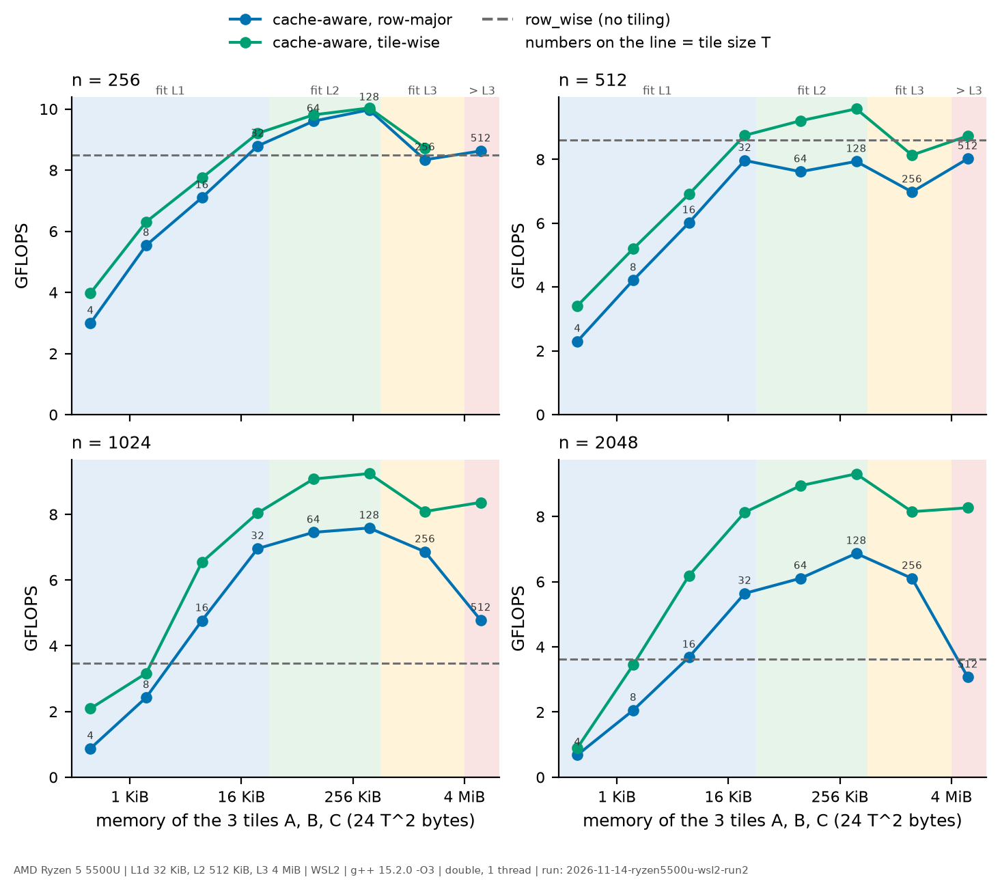
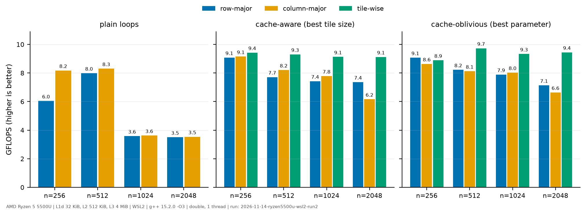

# Experiment 01: Matrix multiplication — cache, layouts and tiling

**Findings (results + drawbacks in one place):** [docs/findings-log.md](../../docs/findings-log.md)  
**Figures (charts to show and how to explain them):** [docs/01-matrix-multiplication/](../../docs/01-matrix-multiplication/README.md)

## How to read this folder

| You want… | Open |
| --- | --- |
| Agenda of what happened (below) | this README |
| All results and drawbacks, short | [docs/findings-log.md](../../docs/findings-log.md) |
| Charts for a talk or the thesis | [docs/01-matrix-multiplication/README.md](../../docs/01-matrix-multiplication/README.md) |
| Full tables and theory of 14 Nov | [14-nov.txt](14-nov.txt) |
| Cache theory notes | [01-nov.txt](01-nov.txt) |
| Raw CSV | `results/<date>-<machine>/` |

## Agenda — what happened in this experiment

1. **Access order (October 2026)**  
   Compared textbook `naive` loops (column walk on B) with `row_wise` and a first `tiled` version. Measured time, `perf` cache counters, and a no-SIMD build.  
   → Results in this README (October section) · data `results/2026-10-18-ryzen5500u-wsl2/`

2. **Three storage layouts + cache-aware + cache-oblivious (14 November)**  
   Same product on **row-major**, **column-major** and **tile-wise** layouts; each with plain loops, cache-aware tiling, and cache-oblivious recursion (**nine versions**).  
   → [14-nov.txt](14-nov.txt) · data `results/2026-11-14-ryzen5500u-wsl2-run2/` · charts under `docs/01-matrix-multiplication/figures/...-run2/`

3. **Tile-size sweep and “does the tile fit?”**  
   Tile sizes **T = 4 … 512** on row-major and tile-wise, for n = 256 … 2048. Answers: best T, U-shaped curve, behaviour when three tiles no longer fit L1/L2/L3.  
   → Tables below and in 14-nov.txt · charts `tile_size_vs_time`, `tile_fit_regimes`

4. **Cache regimes from the professor’s cases**  
   - *Whole matrix > cache > single row:* n = 1024 and 2048 (measured fully).  
   - *Single row > cache:* n = 4096 only **partly** measured (stopped on purpose: work grows as n³, full sweep >1 hour). n = 8192 does not fit in ~3 GB WSL memory.  
   → 14-nov.txt §7.4 · `results/...-run2-n4096/`

5. **Figures for presenting (15 November)**  
   Python/matplotlib tool; all charts organised under `docs/01-matrix-multiplication/`. Multi-layout cache-counter run started then **stopped** (incomplete).  
   → [15-nov.txt](15-nov.txt) · [docs/01-matrix-multiplication/README.md](../../docs/01-matrix-multiplication/README.md)

**Professor’s weekly tasks — status:** (1) cache-oblivious on all three layouts — done · (2) cache-aware and compare — done · (3) different tile sizes / tile fit / matrix vs cache — done for n ≤ 2048; “single row > cache” only partial.

## Research question

How much does memory layout and access order cost in matrix multiplication? Can tiling (cache-aware) and recursion (cache-oblivious) fix it when the data no longer fits in cache? Can cache measurements explain the differences?

## Theory

A CPU fetches data in chunks called cache lines (typically 64 bytes, i.e. 8 `double` values), not one number at a time. When a cache line is loaded, nearby elements are already available for the next accesses.

```text
A = [ 1  2  3  4  5]
    [ 6  7  8  9 10]
    [11 12 13 14 15]
```

1. **Moving across a row (good spatial locality).** `1 -> 2 -> 3 -> 4` are consecutive in memory. One cache line serves several accesses.
2. **Moving down a column (poor spatial locality).** `1 -> 6 -> 11` skip the rest of the row. For a matrix with `n` columns the distance between vertical neighbours is

   ```text
   stride = n * sizeof(element)
   ```

   For `double` and `n = 512` that is 512 \* 8 = 4096 bytes. Almost every access touches a different cache line, so a vertical traversal can touch many cache lines even when the whole matrix is small.

## Versions (`main.cpp`)

All versions compute the same product `C = A * B` and produce identical checksums. The October work used the first three (row-major only). From 14 November there are **nine** versions: three layouts × (plain loops / cache-aware / cache-oblivious). Details: [14-nov.txt](14-nov.txt) §4.

| Name | Role |
| ---- | ---- |
| `naive` | Textbook i,j,k — inner loop walks **down a column** of B |
| `row_wise` / `col_wise` | Plain loops matched to row-major / column-major |
| `tiled` / `tiled_col_major` / `tiled_tile_wise` | Cache-aware tiling on each layout |
| `oblivious_row_major` / `oblivious_col_major` / `oblivious_tile_wise` | Cache-oblivious recursion on each layout |

Every run checks its result against a reference (`naive` or `row_wise`) before timing.

## How to build and run

From the repository root, see the main [README](../../README.md) for the build instructions (Release is the default build type). Then, for example:

```bash
./build/experiments/01-matrix-multiplication/matrix_multiplication row_wise 512
```

Usage: `matrix_multiplication <version> <n> [repetitions=7] [tile_size=32] [reference=naive|row_wise]`

The program prints a CSV header and one result row. Version names are listed above.

To reproduce all results (build, timings, cache counters, no-SIMD check, environment file) on Linux or WSL:

```bash
bash scripts/run.sh experiments/01-matrix-multiplication
```

This uses the shared tooling in [`scripts/`](../../scripts/README.md) with this experiment's [`benchmark.conf`](benchmark.conf) (target, versions, sizes, repetitions). It writes a new folder under `results/` named `<date>-local`; rename it to `<date>-<machine>` if you keep it. It takes roughly 5 to 10 minutes on the machine below, mostly because of `naive` at n=1024. To run only some checks, add their names (`environment`, `timings`, `cache_counters`, `no_vectorization`).

## Method

- Machine: AMD Ryzen 5 5500U, WSL2 (Ubuntu 26.04), g++ 15.2.0, `-O3 -DNDEBUG` (Release). Caches: L1d 32 KiB per core, L2 512 KiB per core, L3 4 MB. Full details: `results/2026-10-18-ryzen5500u-wsl2/environment.txt`.
- Matrices of `double`, uniform random in [-1, 1], fixed seed (12345). Each version runs in its own process.
- Timing: one warm-up run, then the median of the repeated runs (7 repetitions, 5 at n=1024). Allocation and input generation are outside the timed region.
- Cache counters: `perf stat` (user-mode events). The program also runs a reference multiply and setup in the same process. To remove that, each version was run with 1 and with 4 repetitions, and the counter difference was divided by 3. All values are per multiplication.

## Results (`results/2026-10-18-ryzen5500u-wsl2/`)

### Execution time (`timings.csv`)

| n    | naive (ms) | row_wise (ms) | tiled (ms) | naive / row_wise | row_wise / tiled |
| ---- | ---------- | ------------- | ---------- | ---------------- | ---------------- |
| 64   | 0.136      | 0.052         | 0.058      | 2.6x             | 0.9x             |
| 128  | 2.20       | 0.41          | 0.48       | 5.4x             | 0.9x             |
| 256  | 38.2       | 4.06          | 4.01       | 9.4x             | 1.0x             |
| 512  | 832        | 34.0          | 36.4       | 24.5x            | 0.9x             |
| 1024 | 8630       | 742           | 369        | 11.6x            | 2.0x             |

- Reordering the loops (`naive` to `row_wise`) gives a speedup that grows with n, up to about 25x at n=512.
- At n=1024 the `naive` / `row_wise` ratio drops to 11.6x because `row_wise` itself slows down: from 7.9 GFLOPS at n=512 to 2.9 GFLOPS at n=1024.
- Tiling gives no gain up to n=512, but is **2x faster than `row_wise` at n=1024**. A likely reason is that B (2 MB at n=512) still fits in L3 (4 MB), while B at n=1024 (8 MB) does not.
- Run-to-run variation under WSL2 is large: `naive` at n=512 measured between 822 and 1148 ms across several runs, and the `naive` / `row_wise` ratio at n=512 between 24.5x and 30x. A full re-run with the scripts on a laptop running on battery (Balanced power plan, other programs open) was 10% to 160% slower in absolute time than the data below, while giving identical checksums, L1 miss rates within about 2 percentage points, and the same conclusions (12x, 30x and 12x for `naive` / `row_wise` at n = 256, 512, 1024; `tiled` 2.1x faster than `row_wise` at n=1024). For timing runs, plug the laptop in, use a high-performance power plan and close other programs. Treat speedups as approximate.

### Cache counters (`cache-counters.csv`)

| n    | Version  | L1d loads | L1d load misses | L1 miss rate | Cache misses (generic event) |
| ---- | -------- | --------- | --------------- | ------------ | ---------------------------- |
| 512  | naive    | 213 M     | 138.8 M         | 65.1%        | 135.9 M                      |
| 512  | row_wise | 204 M     | 17.3 M          | 8.5%         | 0.49 M                       |
| 512  | tiled    | 208 M     | 37.8 M          | 18.1%        | 1.72 M                       |
| 1024 | naive    | 1970 M    | 1181 M          | 60.0%        | 1092 M                       |
| 1024 | row_wise | 1614 M    | 133.4 M         | 8.3%         | 9.4 M                        |
| 1024 | tiled    | 1652 M    | 315.0 M         | 19.1%        | 12.7 M                       |

- `naive` misses L1 on 60 to 65% of loads, against about 8% for `row_wise`. That is 8 to 9 times more L1 misses.
- On the generic cache-misses event, `naive` has 116 to 275 times more misses than `row_wise`.
- This supports the cache explanation: the column walk in `naive` causes far more cache misses, and it is much slower.

### Cache or vectorisation? (`no-vectorization-512.csv`)

Same code at n=512, compiled with `-fno-tree-vectorize -fno-tree-slp-vectorize`:

| Version  | With auto-vectorisation (ms) | Without (ms) |
| -------- | ---------------------------- | ------------ |
| naive    | 832                          | 799          |
| row_wise | 34.0                         | 56.0         |
| tiled    | 36.4                         | 57.5         |

Without SIMD, `row_wise` is still **14x faster** than `naive` (versus 24.5x with SIMD). Roughly, about 14x of the gap comes from memory-access order and a further factor of about 1.7x from the compiler vectorising `row_wise` (it cannot vectorise the `naive` sum without relaxing floating-point rules).

## Conclusions

1. Row-wise (contiguous) access in the inner loop is the main factor. Reordering loops alone gives 10 to 25x at n >= 256, with the same arithmetic and the same result.
2. Cache counters back this up: the column-wise version has about 8x more L1 misses and over 100x more last-level cache misses.
3. Tiling pays off once the working set no longer fits in L3 (2x at n=1024). It does not at n <= 512.

## Results — November 2026: tile sizes, layouts, cache-aware and cache-oblivious

Measured on the same machine as above, but in a new session with the laptop on AC power and the Windows High performance plan (`results/2026-11-14-ryzen5500u-wsl2-run2/`, conditions in `run-conditions.txt`). Full method, theory, predictions and every table are in [14-nov.txt](14-nov.txt). A first run of the same day (`results/2026-11-14-ryzen5500u-wsl2/`) was noisy (Balanced plan, other programs open) and is kept but not used.

New versions: the same product on three storage layouts (row-major, column-major, tile-wise = each tile contiguous), each with plain loops, a cache-aware tiled algorithm, and a cache-oblivious recursive algorithm (nine versions in total, see `14-nov.txt`, section 4). All give identical checksums.

Noise: `row_wise` was timed twice per size in the same run and differed by 3% (n=1024, 2048) to 7% (n=512). Differences below about 10% are not reliable, and nothing can be read from n=256.

**Tile size** (median ms, `tiled` on the row-major layout and `tiled_tile_wise` on the tile-wise layout):

| n    | row_wise | row-major T=4 | T=32 | T=128 | T=512 | tile-wise T=4 | T=32 | T=128 | T=512 |
| ---- | -------- | ------------- | ---- | ----- | ----- | ------------- | ---- | ----- | ----- |
| 1024 | 619      | 2456          | 309  | 283   | 449   | 1027          | 267  | 232   | 257   |
| 2048 | 4735     | 25061         | 3046 | 2502  | 5591  | 19000         | 2114 | 1846  | 2078  |

- The curve over the tile size is U-shaped for n >= 1024 on both layouts. T=128 is best everywhere (T=64 is within 2% to 13%). The prediction from the cache sizes was T=16 to 64 (tiles fitting L1); the measured optimum is the L2-sized tile.
- Very small tiles are much slower than no tiling at all (T=4 at n=2048 is 5.3 times slower than `row_wise`).
- For n >= 1024 the best tile is 1.9 to 2.2 times faster than `row_wise` on row-major and about 2.6 times on tile-wise. At n=256 and n=512 tiling gives no clear gain.
- **A tile that does not fit in cache:** on the row-major layout the time more than doubles from T=128 to T=512 at n=2048 (and is 18% worse than `row_wise`). On the tile-wise layout it only rises by 13%. At the same tile size the tile-wise layout is 13% to 18% faster at n=1024 and 25% to 32% faster at n=2048 (63% at T=512).
- Why the tile-wise layout is faster was not measured in this session (no finished counters for all layouts; see Limitations). The likely reasons are conflict misses, TLB misses and prefetching, but these are hypotheses.

**Layouts, cache-aware and cache-oblivious** (median ms, best parameter of each, n=2048):

| Layout       | plain loops | cache-aware (tiled) | cache-oblivious |
| ------------ | ----------- | ------------------- | --------------- |
| row-major    | 4905        | 2333                | 2408            |
| column-major | 4856        | 2787                | 2588            |
| tile-wise    | -           | 1884                | 1819            |

- Cache-oblivious is as fast as the best tuned cache-aware version on every layout (within 7%, which is about the noise level), without choosing a tile size. The expected 10% to 30% slowdown from the recursion did not appear.
- Column-major mirrors row-major for the plain loops (within 2%). For the tiled versions it is similar but up to 20% slower at n=2048, for an unknown reason.
- The fastest version overall at n=2048 is the cache-oblivious recursion on the tile-wise layout (1819 ms, 9.4 GFLOPS, 2.7 times faster than `row_wise`). `oblivious_tile_wise` is only partly oblivious: the tile size is part of the layout. A fully oblivious layout (Z-order) was not implemented.
- The oblivious versions do depend somewhat on their parameter (smallest recursion block, up to about 20% at n=2048).

**n = 4096 ("a row as large as L1")** is only partly measured on purpose: the work grows as n³, so one multiply already takes about 20 to 40 s and a full tile/layout/oblivious sweep was expected to take more than an hour. The session was stopped after four runs (see `results/2026-11-14-ryzen5500u-wsl2-run2-n4096/STOPPED.txt` and `14-nov.txt`, section 7.4). `row_wise` took 37.5 s (3.7 GFLOPS, the same speed per operation as at n=2048) and `tiled` with T=128 took 20.9 s (1.8 times faster). The expected extra slowdown of `row_wise` once the rows leave L1 was not seen. Large tile sizes (T up to 512) were already measured at n ≤ 2048; the wall-time limit is the matrix size, not the tile size. n=8192 does not fit in the 3 GB of memory of this WSL2.

### Figures of the 2026-11-14 session

All figures of this experiment (17 charts and 2 diagrams, with an explanation of each) are in [docs/01-matrix-multiplication/](../../docs/01-matrix-multiplication/README.md). They are generated from the CSV files with `scripts/plot/`. The grey bands mark the +-10 % noise level. Speed-ups in the figures use the `row_wise` row of the same CSV file, so they can differ by about 0.1 from the tables above. A selection:






Diagrams for the explanation (computed from the same index formulas as `main.cpp`): [memory layouts](../../docs/01-matrix-multiplication/diagrams/memory_layouts.png), [recursion of the cache-oblivious algorithm](../../docs/01-matrix-multiplication/diagrams/recursion_steps.png).

## Dated session notes

Theory, plans and results of each working day are kept in a text file named after the day, next to this README. Raw data goes to `results/<date>-<machine>/`; older folders are never overwritten.

| Note | Topic | Data |
| ---- | ----- | ---- |
| `01-nov.txt` | Cache theory (levels, cache lines, misses, AMAT) | none |
| `14-nov.txt` | Tile-size sweep, three layouts, cache-aware and cache-oblivious: theory, plan, full results | `results/2026-11-14-ryzen5500u-wsl2-run2/` (main); `...-run2-n4096/` (partial, stopped for time); `2026-11-14-ryzen5500u-wsl2/` (first run, noisy, not used) |
| `15-nov.txt` | Figures for the report; `perf` available again; multi-layout cache-counter run started and stopped | figures in `docs/01-matrix-multiplication/`; partial counters in `results/2026-11-15-ryzen5500u-wsl2-counters/` (not a finished result) |

Added on 2026-11-14 (the results above are unchanged, the old commands behave as before):

- An optional fifth argument, `reference` (`naive` default, or `row_wise`), selects the version the result is checked against, so that large sizes do not spend minutes in the `naive` check.
- Six more versions: `col_wise`, `tiled_col_major`, `tiled_tile_wise`, `oblivious_row_major`, `oblivious_col_major`, `oblivious_tile_wise`. They run the same multiplication on a column-major or tile-wise layout, cache-aware (tiled) or cache-oblivious (recursive). The input is converted to the layout before timing and the result is converted back for the check. Explained in `14-nov.txt`.
- Two measurement checks, `tile_sweep` and `oblivious` (see [scripts/README.md](../../scripts/README.md)). They are not part of the default run.

## Limitations / drawbacks

The short list for the thesis outline is in [docs/findings-log.md](../../docs/findings-log.md) (Drawbacks and limits). Detail:

- Counters under WSL2 are approximate (user-mode events; demand misses only). Use ratios, not absolute counts.
- **The counters do not explain why `tiled` beats `row_wise` at n=1024** (`tiled` can show more L1 misses yet run faster). Mechanism remains a hypothesis.
- No finished counters for all layouts (October: three versions only; multi-layout run of 2026-11-15 stopped — partial CSV only).
- Large **n** limited by wall time (n³) and memory: n=4096 partial; n=8192 does not fit. Large **tiles** (T≤512) were measured at n≤2048.
- Noise 3–7%; differences under ~10% unreliable. One machine, one thread, `double` only. No Z-order. No error bars. Code not committed when November timings were taken.
