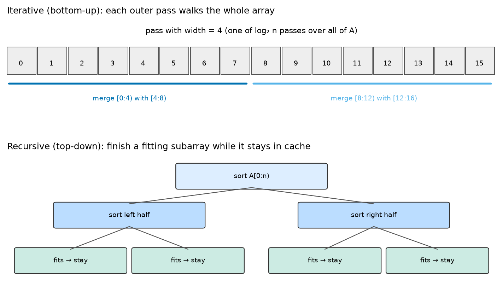
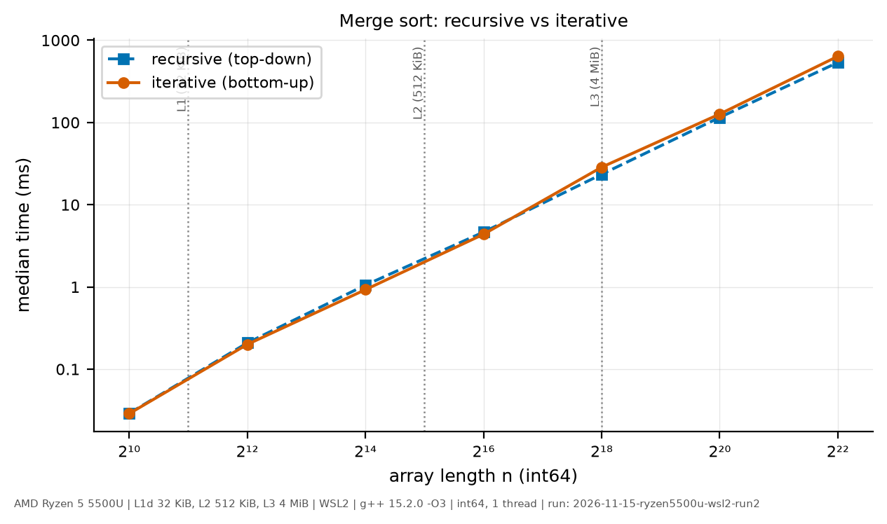
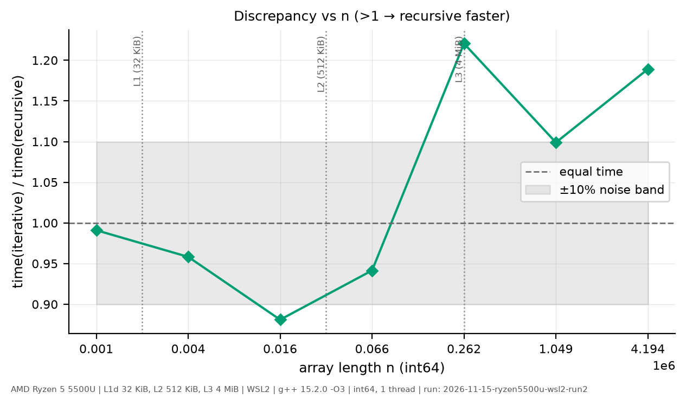
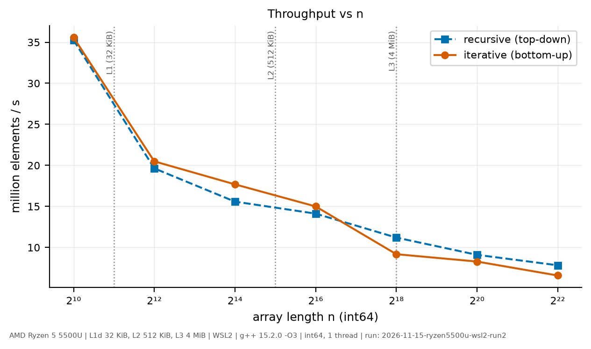
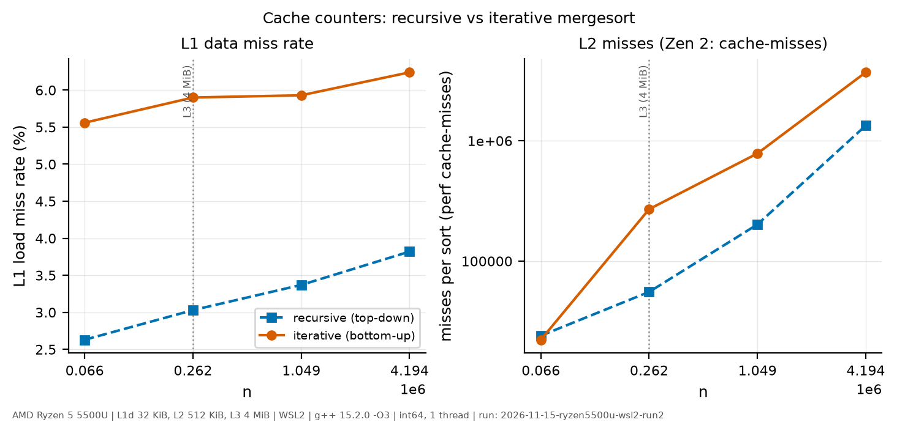
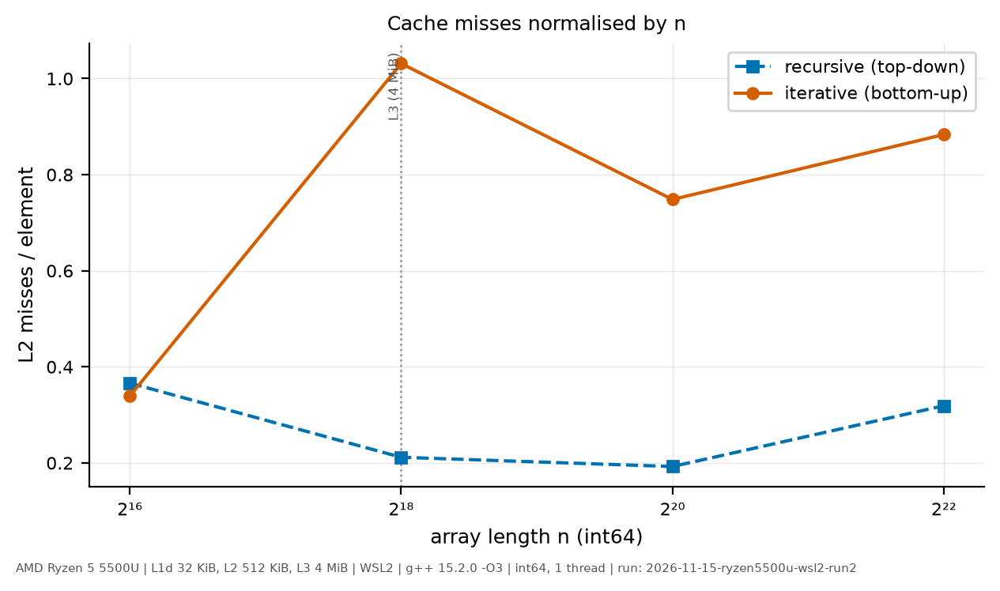
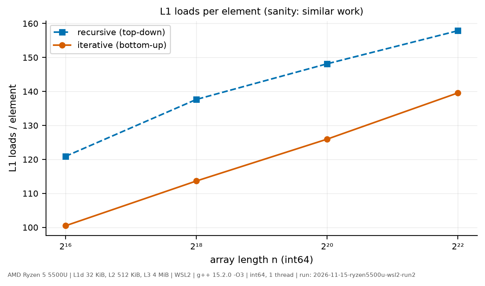

# Experiment 02: Merge sort and the cache

**Status:** **complete** (tasks 5–10). Measured twice on 2026-11-15 (Ryzen 5 5500U / WSL2). Agenda: [docs/agenda.md](../../docs/agenda.md). Findings: [docs/findings.md](../../docs/findings.md). Shared cache theory: [docs/theory/caches.md](../../docs/theory/caches.md).

## 1. Question

Mergesort can be written two ways that do the same merges:

1. **Recursive (top-down):** split `A` into left and right halves, sort each recursively, then merge.
2. **Iterative (bottom-up):** unroll the recursion — merge adjacent pairs, then quadruples, then octets, … until the array is sorted (outer loop over powers of 2, inner loop over blocks).

The iterative version has no recursion overhead, but every outer pass walks the whole array; for large `A` that can reload all of `A` into the cache on every pass. The recursive version, once a subarray fits in the cache, keeps working on that subarray until it is sorted. Which is faster, and how does the gap change with `n`?

## 2. Versions

Both in [`main.cpp`](main.cpp). Same `merge`, same temporary buffer of length `n`, same random `int64` input (fixed seed). Each run checks its result against a reference version before timing.

| Version | Idea |
| --- | --- |
| `recursive` | classic top-down: recurse on `[lo, mid)` and `[mid, hi)`, then `merge` |
| `iterative` | bottom-up: `for width = 1, 2, 4, …` merge adjacent blocks of that width |

`n` should be a power of 2 (as in the professor's unrolling). The program still accepts other lengths.

The sixth CSV column is named `gflops` for the shared scripts; here it holds **million elements sorted per second**.



## 3. Theory

Ideal cache: `Z` words, line size `L` words; `Q` = lines transferred. Elements are 8 bytes (`int64`); `L = 8` on this machine. Working set for mergesort ≈ array + temp ≈ `2n` words.

### Recursive mergesort

When a subproblem of size `m` fits in cache (`2m ≲ Z`), sorting it costs about one cold load of those words, then the remaining merges hit. The largest such subproblem has `m ≈ Z/2`, so the levels that do **not** fit number about `log₂(2n/Z)`. Each such level scans `Θ(n)` words → classic recursive binary-mergesort bound (Frigo et al. / Brodal surveys):

\[
Q_{\mathrm{rec}} = O\Bigl(\frac{n}{L}\bigl(1 + \log_{2}\frac{n}{Z}\bigr)\Bigr).
\]

Compared with the iterative bound below, the ratio of the leading terms is

\[
\frac{Q_{\mathrm{iter}}}{Q_{\mathrm{rec}}} \approx \frac{\log_2 n}{\log_2(2n/Z)}
\]

when \(n > Z\). That ratio is **not** \(\log_2 Z\). \(\log_2 Z\) is only the difference of the two logarithms, so the iterative version moves about \((n/L)\log_2 Z\) *extra* lines; the factor between the two counts falls back toward 1 for very large \(n\). On this L2 (\(Z = 2^{16}\) elements) at \(n = 2^{22}\) the ideal-cache ratio is \(22/7 \approx 3.1\). The recursive bound is still a factor \(\Theta(\log(Z/L))\) above the Aggarwal–Vitter sorting lower bound (funnelsort closes that gap).

### Iterative (bottom-up) mergesort

There are `log₂ n` passes. If `n ≫ Z`, each pass reads/writes the whole array (and temp) with little reuse from the previous pass:

\[
Q_{\mathrm{iter}} = \Theta\Bigl(\frac{n}{L}\log n\Bigr).
\]

Same leading `n/L`. The measured L2-miss ratio at \(n = 2^{22}\) is about 2.6–2.8 (both sessions), close to the ideal-cache 3.1: the timed run also copies the input back, the early passes are not all equally cold, and `perf` does not count L2 prefetches.

### Regimes on this machine (working set `16n` bytes)

Working set = array + temp = `16n` bytes. A level is crossed when that working set passes the cache (`n = cache_bytes / 16`): L1 at \(n = 2^{11}\) (2048), L2 at \(n = 2^{15}\) (32768), L3 at \(n = 2^{18}\) (262144).

| Regime | `n` | Expectation |
| --- | --- | --- |
| fits in L1 (`16n ≤ 32 KiB`) | `n ≤ 2¹¹` | both similar; recursive call overhead may lose |
| past L1, fits in L2 | `2¹² … 2¹⁴` | still mostly inside the noise |
| past L2, fits in L3 | `2¹⁶ … 2¹⁷` | iterative can still win: the whole array is reloaded, but from L3 |
| at / past L3 | `n ≥ 2¹⁸` | recursive should show the clearest advantage |

### Lower bounds for sorting (literature, task 10)

In the **I/O model** of Aggarwal & Vitter (1988), comparison-based sorting needs

\[
\Theta\Bigl(\frac{N}{B}\log_{M/B}\frac{N}{B}\Bigr)
\]

block transfers (`M` = memory words, `B` = block / line words). That is also a lower bound for the **ideal-cache / cache-oblivious** model of Frigo, Leiserson, Prokop & Ramachandran (1999), because any cache-oblivious algorithm can be read as an I/O algorithm for every `M`, `B`.

| Algorithm | Cache / I/O cost | Notes |
| --- | --- | --- |
| Recursive binary mergesort | \(O\bigl(\frac{N}{B}\bigl(1+\log_{2}\frac{N}{M}\bigr)\bigr)\) | cache-oblivious; factor \(\Theta(\log(M/B))\) above the lower bound |
| Bottom-up (iterative) mergesort | \(\Theta\bigl(\frac{N}{B}\log_{2} N\bigr)\) when \(N \gg M\) | no \(M\) in the log; worst of the three for large \(N\) |
| Funnelsort (Frigo et al.) | \(O\bigl(\frac{N}{B}\log_{M/B}\frac{N}{B}\bigr)\) | matches the lower bound under the **tall-cache** assumption \(M=\Omega(B^{2})\) |
| Lower bound (any comparison sort) | \(\Omega\bigl(\frac{N}{B}\log_{M/B}\frac{N}{B}\bigr)\) | Aggarwal–Vitter; Brodal & Fagerberg: optimal cache-oblivious sorting needs a tall-cache assumption |

**Empirical precedent:** LaMarca & Ladner (*The Influence of Caches on the Performance of Sorting*, 1999) already showed that restructuring mergesort / quicksort / heapsort for cache locality changes wall-clock time a lot; our recursive-vs-iterative comparison is the same phenomenon on modern hardware with `perf` counters.

Our experiment implements classic binary mergesort only (not funnelsort). Theory predicts an L2-miss ratio near \(\log_2 n / \log_2(2n/Z)\) (about 3.1 at \(n = 2^{22}\) on this L2), not a factor \(\log_2 Z\), and it does **not** say that recursive binary mergesort is I/O-optimal — funnelsort would be needed for that.

## 4. Method

- **Machine / toolchain:** same as experiment 01 (see `environment.txt` of each session).
- **Input:** `n` random `int64` values, seed `12345`; temp buffer of length `n`.
- **Timing:** one warm-up, then median of `REPS` (or `REPS_LARGE` for large `n`). Each repetition restores the unsorted input (copy included in the timed region — same for both versions).
- **Counters:** `perf` as in experiment 01; on Zen 2 `cache-misses` = **L2** misses.

| Check | Output |
| --- | --- |
| `environment` | `environment.txt` |
| `timings` | `timings.csv` |
| `cache_counters` | `cache-counters.csv` |

## 5. Results

Two sessions (same machine, same code): [`…-wsl2/`](results/2026-11-15-ryzen5500u-wsl2/) and [`…-wsl2-run2/`](results/2026-11-15-ryzen5500u-wsl2-run2/). Numbers and figures below are **run2**; run1 confirms the same crossover. Checksums match recursive = iterative at every `n`.

### 5.1 Time vs n





| n | recursive (ms) | iterative (ms) | ratio it/rec (run2) | ratio (run1) |
| ---: | ---: | ---: | ---: | ---: |
| 1 024 | 0.029 | 0.029 | 0.99 | 0.83 |
| 4 096 | 0.209 | 0.200 | 0.96 | 0.95 |
| 16 384 | 1.05 | 0.93 | 0.88 | 0.92 |
| 65 536 | 4.64 | 4.37 | 0.94 | 0.93 |
| 262 144 | 23.4 | 28.6 | **1.22** | **1.17** |
| 1 048 576 | 115 | 127 | **1.10** | **1.15** |
| 4 194 304 | 536 | 637 | **1.19** | **1.20** |



- While the working set still fits in L3 (`n ≤ 65 536`, 1 MiB against a 4 MiB L3), **iterative is a few percent faster** (no recursion overhead; mostly inside the ±10% noise band). `n = 65 536` is already past L2.
- From the L3 boundary upward (`n ≥ 262 144`, working set = 4 MiB), **recursive is ~10–22% faster** in both runs — the discrepancy flips with `n` as asked in task 8.

### 5.2 Cache counters





| n | L2 misses rec | L2 misses it | L2 ratio (run2) | L2 ratio (run1) | L1 miss % rec | L1 miss % it |
| ---: | ---: | ---: | ---: | ---: | ---: | ---: |
| 65 536 | 24.0 k | 22.2 k | 0.93* | **2.76×** | 2.6 | 5.6 |
| 262 144 | 55.5 k | 270 k | **4.87×** | **2.35×** | 3.0 | 5.9 |
| 1 048 576 | 202 k | 785 k | **3.89×** | **2.41×** | 3.4 | 5.9 |
| 4 194 304 | 1.34 M | 3.71 M | **2.77×** | **2.64×** | 3.8 | 6.2 |

\*At `n = 65 536`, WSL2 `perf` counts are noisy (run1 and run2 disagree); L1 miss *rate* still favours recursive. From `n ≥ 262 144` both sessions agree: iterative has **~2.4–4.9× more L2 misses**. At \(n = 2^{22}\) that is 2.64× and 2.77×, against the ideal-cache prediction of about 3.1 on L2 (§3).

- L2 misses per element stay lower for recursive; iterative climbs — the full-array-pass story.
- L1 *loads* per element are a bit higher for recursive (call / stack traffic); the timing win tracks **L2 misses**, not raw L1 load count.



Figure catalogue (needs / meaning): [scripts/plot/README.md](../../scripts/plot/README.md#figures-for-experiment-02).

## 6. Conclusions

- **Tasks 5–6:** both versions implemented with a shared `merge`; iterative is the unrolled power-of-2 schedule.
- **Tasks 7–8:** for small `n`, iterative wins on overhead; for large `n` (past L3), recursive wins on locality. Reproduced in two sessions: ratio flips around L3 and reaches ~1.2× at `n = 2²²`.
- **Task 9:** L2 misses support `Q_iter ≫ Q_rec` (about 2.5–5× for `n ≥ 2¹⁸`). Timing gap < miss gap (CPU work still matters; both do `Θ(n log n)` comparisons).
- **Task 10:** matches the literature: recursive binary mergesort is the cache-oblivious flavour with \(O((N/B)\log(N/M))\); iterative pays \(\Theta((N/B)\log N)\). With the temporary buffer counted, the ratio of those two is \(\log_2 n / \log_2(2n/Z)\), about 3.1 on this L2 at \(n = 2^{22}\), not \(\log_2 Z\). The Aggarwal–Vitter lower bound is tighter still and needs funnelsort + a tall cache to match.

## 7. Limits

- Restoring the input each repetition adds an `O(n)` copy to every timed run.
- Recursion depth is `log₂ n` (fine up to `n = 2²⁴` and beyond on this stack).
- WSL2: no L3/RAM counters; L3 effects appear only in timings.
- Optimal cache-oblivious sorting (funnel sort) is not implemented — only classic mergesort.

## 8. Reproduce

```bash
bash scripts/run.sh experiments/02-merge-sort environment timings cache_counters \
  --out experiments/02-merge-sort/results/$(date +%F)-ryzen5500u-wsl2
```

Quick smoke test:

```bash
SIZES="1024 4096 16384" COUNTER_SIZES="16384" COUNTER_RUNS=3 \
  bash scripts/run.sh experiments/02-merge-sort environment timings cache_counters \
  --out /tmp/mergesort-smoke
```

Figures:

```powershell
.\.venv\Scripts\python.exe scripts/plot/make_figures.py experiments/02-merge-sort/results/<session>
.\.venv\Scripts\python.exe scripts/plot/make_figures.py --diagrams --experiment 02-merge-sort
```

Manual binary:

```bash
cmake -S . -B build/02-merge-sort-release -DCMAKE_BUILD_TYPE=Release
cmake --build build/02-merge-sort-release --target merge_sort --parallel
./build/02-merge-sort-release/experiments/02-merge-sort/merge_sort recursive 65536
```
